# Architecture and inference design

```mermaid
flowchart LR
    R[regions.csv] --> V[Schema and 24-frame validation]
    N[nodes.csv] --> V
    P[node_positions.csv / environment JSON] --> M[Resolve IDs to coordinates]
    D[diss.csv / output.txt] --> H[Functional and demographic priors]
    S[nodes_sir.csv] --> X[Optional status extension]
    V --> B[Origin production / destination attraction]
    B --> A[Balance and residual audit]
    G[OSM drive or walking graph] --> C[Directed shortest-path costs]
    M --> C
    C --> F[Log-domain Furness / entropy fit]
    A --> F
    F --> K[k-shortest street paths / speed timestamps]
    G --> K
    H --> Q[Estimated flow composition]
    K --> Q
    Q --> J[24-hour manifest + binary route atlas]
    X --> J
    W[Municipal neighborhood polygons] --> J
    J --> L[Validate and preload all assets]
    L --> T[Worker: deterministic sample buffers]
    T --> GPU[GPU path lookup and interpolation]
    GPU --> MAP[Deck.gl + MapLibre]
    L --> UI[Timeline / filters / venue series]
    UI --> GPU
    MAP --> PERF[Completed-render benchmark]
```

## Conservation and entropy solution

For the incoming deltas at h+1, production is `O_i = max(-delta_i, 0)` and
attraction is `D_j = max(delta_j, 0)`. Under explicit normalization,
`D'_j = D_j * sum(O)/sum(D)`. The original residual and scale are retained.
Zero movement produces a zero matrix. One-sided changes require explicit
external sources/sinks and fail, rather than dividing by zero or inventing
origins. No external region is automatically assumed.

For finite directed network cost c in seconds, the kernel is
`K_ij = exp(-beta*c_ij) * prior_ij`. `beta = 1/1800 s^-1` is an illustrative
default, not a calibrated Porto Alegre behavioral coefficient. The library
accepts a positive OD-specific prior. A destination-only multiplicative factor
would cancel in a doubly constrained fit, so occupation attraction is applied
to flow composition rather than misrepresented as changing fixed marginals.

The log-space iteration alternately scales rows and columns to O and D'.
Convergence requires the maximum absolute row/column residual to be within
`1e-7 * max(1,total production)`. Structural zeros remain zero. Empty support
fails immediately; other infeasible support fails at the iteration limit.
Trips are continuous estimated masses, not prematurely rounded individuals.

## Street assignment

Coordinates snap to accessible graph nodes with a checked distance limit.
Shortest costs use OSMnx `travel_time`, derived from OSM maxspeed and explicit
road-class defaults. Each routed edge uses its actual geometry in directed
order. Vertex timestamps are proportional to distance **within that edge**, so
arterial/local speeds differ. Geometry is not replaced by linearly spaced
centroid points. OSM junction topology supplies grade separation; geometric
line crossings are never assumed to be graph connections.

Alternative paths use a logit split of the fitted OD mass. There is no
congestion assignment, road-capacity calibration, turn-restriction relation
model, live closure model or behavioral departure-time model. Those require a
more specialized routing backend or additional observed inputs. The visible
"saturation" refers only to user-specified venue capacity.

When a stadium node's signed change explains at least 80% of its region's
signed change, the regional endpoint is the supplied stadium coordinate for
that interval. This disclosed localization heuristic is useful for surge
inspection; **node mode** should be used for full micro-node inference. Region
and node runs must remain separate to avoid double-counting.

## Browser and GPU data ownership

There are no HTTP requests after initialization for frame seeking or filters.
Four assets preload together: manifest, binary routes, roads, polygons.
The worker builds typed arrays for all hours, transferring their buffers to
the main thread. MapLibre owns camera and the local street basemap. Deck uses
an overlaid WebGL2 canvas synchronized by `MapLibreOverlay`.

The route texture has one RGBA32F texel per street vertex. Red/green are lon/lat;
blue is cumulative travel time normalized by route duration. Each particle
stores route offset, vertex count, deterministic phase and duration, plus
three demographic category indices. Its vertex shader uses binary search to
find the adjacent street vertices and interpolates **only that segment**.
A five-field uniform block carries the animation clock and filter masks.

Origin colors are an additional precomputed Uint8 RGBA attribute per sample,
using a deterministic golden-angle palette keyed by sorted neighborhood names.
Default contrast mode supplies one constant warm-gold color. The renderer
does not derive colors from current position, so a sample keeps its origin
color across the route.

Two separate stock heatmaps aggregate filtered, interpolated populations at
neighborhood centers and supplied non-residential node coordinates. They use
512-pixel aggregation textures and refresh at 2 Hz. Fixed display color domains
avoid re-normalizing away changes from demographic filtering. Tooltip values
are estimated people at the aggregate location, not the visual KDE field.

At each animation frame, only the clock uniform changes. Attribute buffers
remain stable for the whole hour. Filter masks operate on the GPU; UI counts
use a 24-bin joint histogram, and corridor weights update only on filter/hour
changes. Stocks and venue chart update at approximately 7 Hz while the map
animates independently. Seeking changes preloaded buffers synchronously;
GPU uploads, path tessellation and map work can still cost time at a boundary.
There is no claim of measured sub-millisecond complete-layer filtering.

The texture and buffers scale with route vertices plus 50k samples/hour,
not 50k independent copies of every polyline. Static geometry uses PathLayer;
dynamic samples subclass ScatterplotLayer for GPU routing. This avoids
duplicating route vertices for every TripsLayer instance.

## Geographic and operational limits

The included GeoJSON basemap is suitable for a single city and offline
inspection. A larger deployment should tile the same verified road/polygon
sources into PMTiles/MVT while retaining the preloaded simulation atlas.
Basemap tiling does not change OD inference or simulation timing. An Arrow
or DuckDB store is not required for this 24-frame aggregate dataset; the
in-memory typed buffers avoid query overhead in the animation loop.

The pipeline is intentionally independent of the simulator. Existing engine
files and user changes are untouched. A new run is validated before publication;
source SHA-256 hashes and graph fingerprint allow reproduction. For production,
write bundles to a fresh version directory and atomically update the deployed
manifest only after all files are present.
